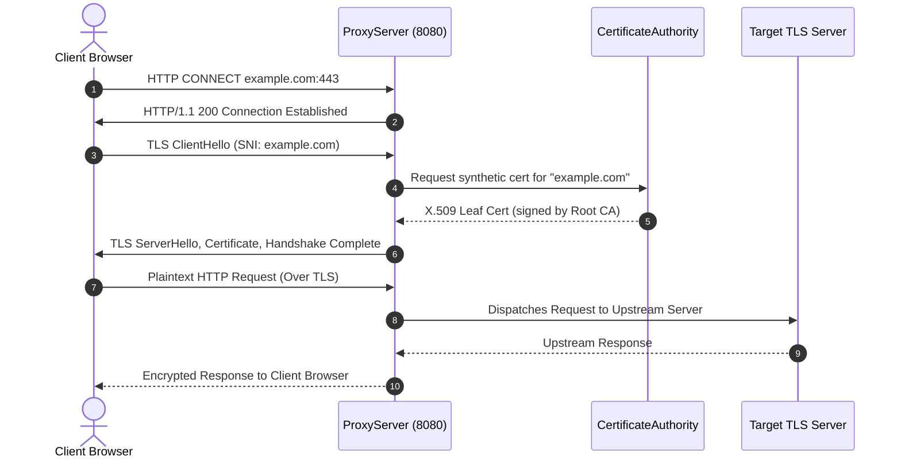

# RustProxy Architectural Specification

RustProxy is architected as a modular, high-performance web traffic analysis platform implemented entirely in Rust 2021, paired with an asynchronous API and a React 19 / TypeScript desktop GUI.

---

## 1. High-Level System Architecture

```mermaid
graph TD
    Client["Client / Web Browser<br/>(Configured Proxy: 127.0.0.1:8080)"] -->|HTTP / CONNECT Tunnel| ProxyListener["rustproxy-proxy<br/>(Hyper 1.0 + Tokio Listener)"]
    
    ProxyListener -->|Plaintext HTTP| RequestPipeline["Request Dispatch Pipeline"]
    ProxyListener -->|CONNECT Host:443| TLSResolver["rustproxy-tls<br/>Dynamic Leaf Cert Synthesizer"]
    TLSResolver -->|TLS Handshake| RequestPipeline
    
    RequestPipeline --> InterceptCheck{"rustproxy-intercept<br/>Intercept ON?"}
    
    InterceptCheck -->|Paused (Pending Queue)| OperatorUI["Desktop / Web GUI<br/>(React 19 + Tailwind CSS)"]
    OperatorUI -->|Forward / Drop Decision| InterceptCheck
    
    InterceptCheck -->|Forward Request| UpstreamClient["rustproxy-http<br/>(Hyper Client)"]
    UpstreamClient -->|Dispatched Request| TargetServer["Upstream Target Server"]
    TargetServer -->|Inbound Response| UpstreamClient
    
    UpstreamClient --> ResponseIntercept{"Response<br/>Intercept ON?"}
    ResponseIntercept -->|Paused (Pending Queue)| OperatorUI
    OperatorUI -->|Forward / Drop Response| ResponseIntercept
    
    ResponseIntercept --> BroadcastBus["tokio::sync::broadcast<br/>ProxyEvent Channel"]
    
    BroadcastBus --> StorageEngine["rustproxy-storage<br/>(SQLite WAL Database)"]
    BroadcastBus --> SiteMapEngine["rustproxy-sitemap<br/>(Hierarchy Aggregator)"]
    BroadcastBus --> ScannerEngine["rustproxy-scanner<br/>(Passive Heuristic Auditor)"]
    
    ResponseIntercept -->|Client Response| Client
    
    subgraph Management Layer
        APIServer["rustproxy-api<br/>(127.0.0.1:8081)"]
        RepeaterEngine["rustproxy-repeater<br/>(Manual Replay)"]
        Decoder["rustproxy-decoder<br/>(Codec Utilities)"]
        Comparer["rustproxy-comparer<br/>(Myers Diff)"]
    end
    
    OperatorUI <-->|JSON REST API & SSE| APIServer
    APIServer --> StorageEngine
    APIServer --> RepeaterEngine
    APIServer --> SiteMapEngine
    APIServer --> Decoder
    APIServer --> Comparer
```

---

## 2. Workspace Crate Decomposition

The Rust workspace consists of 13 cohesive crates located under `crates/`:

```
crates/
├── rustproxy-core         # Common data models, HTTP types, CWE taxonomy, scope definitions
├── rustproxy-tls          # Dynamic CA generation, X.509 leaf certificate synthesis, Rustls resolver
├── rustproxy-storage      # SQLite Write-Ahead Logging (WAL) engine, indexing, and binary BLOB persistence
├── rustproxy-http         # Asynchronous Hyper client, connection establishment, and redirect tracking
├── rustproxy-intercept    # In-memory paused flow queue, oneshot channel dispatch, forward/drop logic
├── rustproxy-sitemap      # Hierarchical URL and endpoint aggregation tree
├── rustproxy-repeater     # Request crafting, execution, tab history, and replay engine
├── rustproxy-scanner      # Passive non-intrusive heuristic vulnerability rules
├── rustproxy-decoder      # Multi-format codec (URL, Base64, Hex, HTML entity)
├── rustproxy-comparer     # Myers textual diff engine for side-by-side payload comparisons
├── rustproxy-proxy        # Core intercepting proxy listener, CONNECT tunnel handler, and event bus
├── rustproxy-api          # Local REST API server, strict CORS validator, and static GUI asset host
└── rustproxy-cli          # Application entrypoint, logging initialization, and lifecycle manager
```

---

## 3. Data & Interception Flows

### 3.1 Plaintext HTTP Interception
1. Client establishes TCP connection to `127.0.0.1:8080`.
2. Hyper parses incoming HTTP/1.1 request line and headers into a `rustproxy_core::RequestModel`.
3. If Intercept is enabled and matches target scope rules, the request is placed into an in-memory `pending_requests` map with a `tokio::sync::oneshot` response channel.
4. The operator inspects, edits, and clicks **Forward** in the GUI, sending the decision through `POST /api/intercept/forward`.
5. The oneshot channel triggers, passing the modified `RequestModel` to `rustproxy_http::HttpClient`.
6. Upstream response is parsed into `ResponseModel` and streamed back to the client.

### 3.2 HTTPS Man-in-the-Middle (MITM) Tunneling


1. Client issues `CONNECT example.com:443 HTTP/1.1`.
2. Proxy responds with `200 Connection Established` and upgrades the socket.
3. Client initiates TLS ClientHello.
4. `rustproxy-tls::DynamicCertResolver` extracts the requested SNI hostname (e.g. `example.com`).
5. `CertificateAuthority` synthesizes an in-memory X.509 v3 leaf certificate on demand, signing it with the local ECDSA P-256 Root CA key.
6. The TLS handshake completes, and plaintext HTTP streams are decrypted, intercepted, logged, and proxied transparently.

---

## 4. Storage Architecture (SQLite WAL)

All persistent traffic is managed by `rustproxy-storage::StorageEngine`:

- **Journal Mode**: Write-Ahead Logging (`PRAGMA journal_mode = WAL`). Readers do not block writers, and writers do not block readers.
- **Synchronicity**: `PRAGMA synchronous = NORMAL` for optimized I/O performance on NVMe/SSD storage.
- **Table Schema**:
  - `flows`: Relational metadata (ID, session, timestamp, method, scheme, host, port, path, status, duration, in-scope flag). Indexed on `timestamp`, `host`, `status_code`, and `in_scope`.
  - `flow_bodies`: Stores serialized raw header vectors and binary payload bodies as `BLOB` fields, preserving full bit-level wire fidelity.
  - `findings`: Relational table storing CWE ID, vulnerability title, severity, confidence, evidence extract, and remediation steps.

---

## 5. Security & Isolation Model

1. **Loopback Binding**:
   - Proxy listener: `127.0.0.1:8080` (strictly loopback).
   - API / GUI server: `127.0.0.1:8081` (strictly loopback).
   - Neither service binds to `0.0.0.0`, preventing exposure to external networks or local LANs.

2. **Strict CORS Defense**:
   - The API server validates the incoming `Origin` HTTP header against trusted origins (`http://127.0.0.1:*`, `http://localhost:*`, `tauri://localhost`).
   - Untrusted cross-origin requests (e.g. from malicious web pages browsed while the proxy is active) are immediately rejected with `403 Forbidden`, preventing unauthorized cross-origin reading of traffic captures or Repeater execution.

3. **Private Key File Permissions**:
   - On Unix/Linux systems, the `~/.rustproxy` directory is created with `0700` (`rwx------`) permissions, and the private key (`rustproxy_ca.key`) is enforced to `0600` (`rw-------`).
