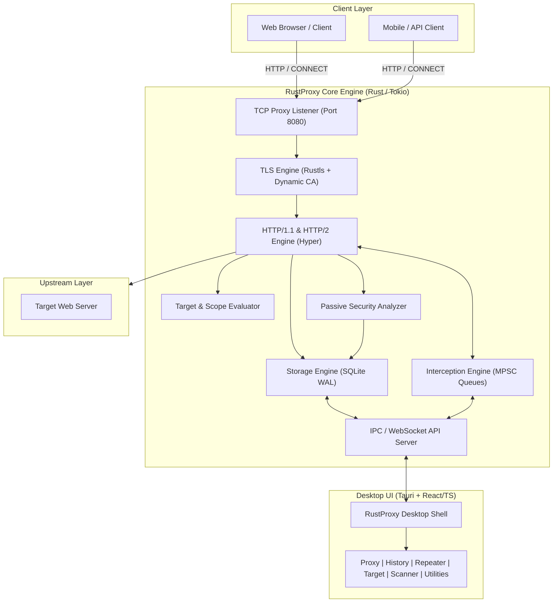

# RustProxy Architecture Specification

`RustProxy` is a modern, modular, defensive web application traffic analysis platform built in Rust. It provides full-featured HTTP/HTTPS traffic inspection, request modification, replay, passive security analysis, and traffic history logging with native performance and memory safety.

---

## 1. System High-Level Architecture



---

## 2. Modular Rust Crate Workspace

The workspace is organized into focused, decoupled crates under `crates/`:

```
rustproxy/
├── Cargo.toml                  # Virtual workspace manifest
├── crates/
│   ├── rustproxy-core/         # Fundamental models: Flow, Headers, Method, Uri, Scope
│   ├── rustproxy-tls/          # Dynamic CA, leaf cert synthesis, rustls configs
│   ├── rustproxy-http/         # Raw wire parsing, HTTP framing, connection pooling
│   ├── rustproxy-storage/      # SQLite WAL persistence, flow indexing, schema migrations
│   ├── rustproxy-intercept/    # Interception queue, pause/resume/drop/modify rules
│   ├── rustproxy-repeater/     # Tabbed manual replay engine, timing, request history
│   ├── rustproxy-sitemap/      # Target tree hierarchy, radix path indexing
│   ├── rustproxy-scanner/      # Passive security audits (headers, cookies, disclosures)
│   ├── rustproxy-decoder/      # Multi-format codec (URL, Base64, Hex, HTML, Gzip, JWT)
│   ├── rustproxy-comparer/     # High-speed Myers diff and byte comparison
│   ├── rustproxy-proxy/        # Core MITM proxy pipeline integrating all crates
│   └── rustproxy-api/          # JSON-RPC & WebSocket API for desktop/headless control
├── desktop/                    # Tauri v2 + React 19 + TypeScript desktop interface
├── research/                   # Technical analysis and specifications
└── tests/                      # End-to-end integration test suites
```

---

## 3. Data Flow & Component Interactions

### 3.1 Inbound Traffic Handling
1. **Connection Acceptance**: `rustproxy-proxy` accepts incoming TCP connections on `127.0.0.1:8080`.
2. **Protocol Detection**:
   - If HTTP `CONNECT`, establish tunnel, read client TLS `ClientHello`, fetch or synthesize leaf certificate via `rustproxy-tls`, and terminate TLS with `rustls`.
   - If plain HTTP, parse request directly via `rustproxy-http`.
3. **Scope Check**: Check URL against `rustproxy-sitemap` scope rules. If out of scope, request can pass through unintercepted or be rejected based on configuration.
4. **Interception Check**: `rustproxy-intercept` evaluates user-defined criteria. If matched and interception is enabled:
   - Request is queued; a notification is pushed via `rustproxy-api` to the UI.
   - Operator may Forward, Drop, or Modify.
5. **Upstream Dispatch**: Request is transmitted to target web server.
6. **Response Processing**: Upstream response is received, evaluated by response intercept rules, saved to `rustproxy-storage`, analyzed asynchronously by `rustproxy-scanner`, and returned to the client.

### 3.2 Threading & Asynchronous Concurrency
- **Tokio Runtime**: Multi-threaded work-stealing executor.
- **Lock-Free State Sharing**: In-memory active connections and queues managed with `Arc`, `RwLock`, and `tokio::sync::mpsc / broadcast`.
- **Zero-Block Database Writes**: Dedicated background worker channel for SQLite batching, eliminating I/O bottlenecks in the network proxy path.
