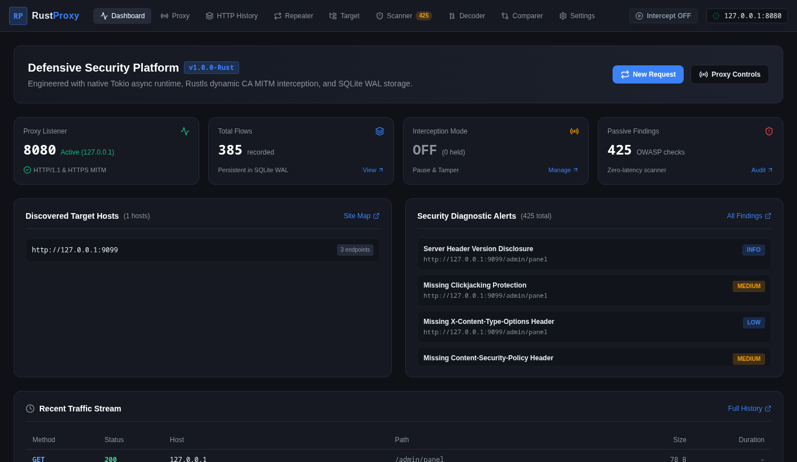
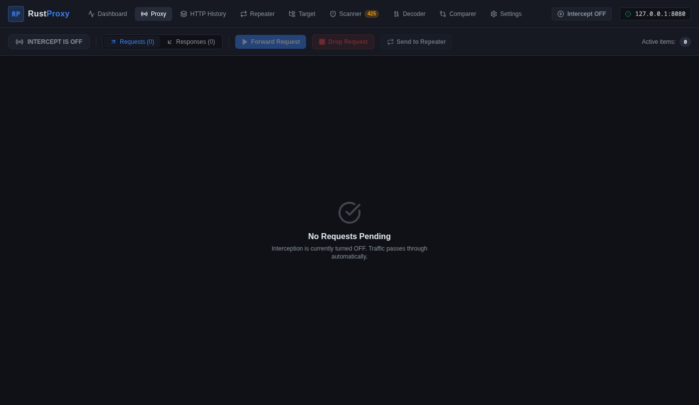
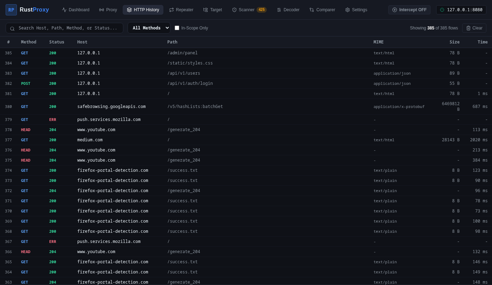
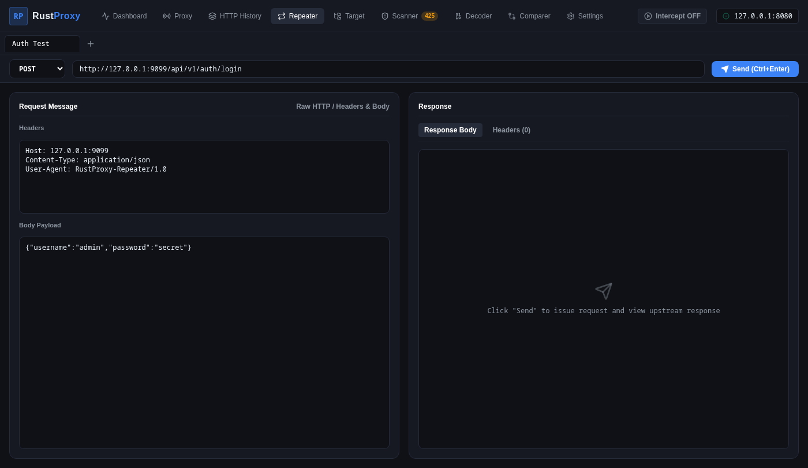
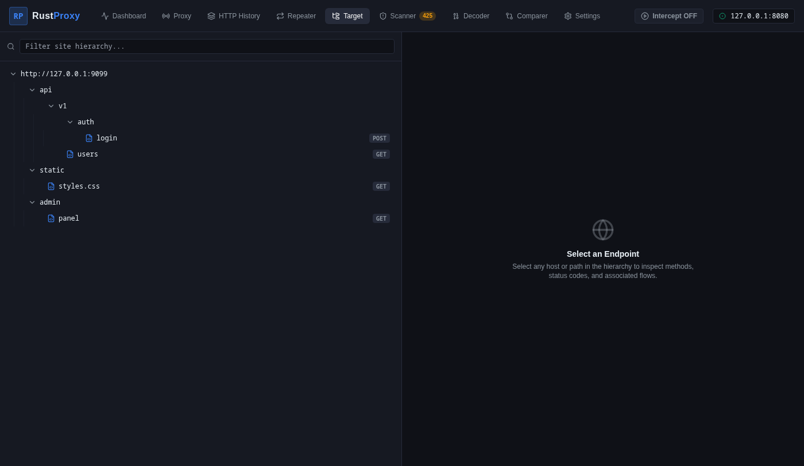
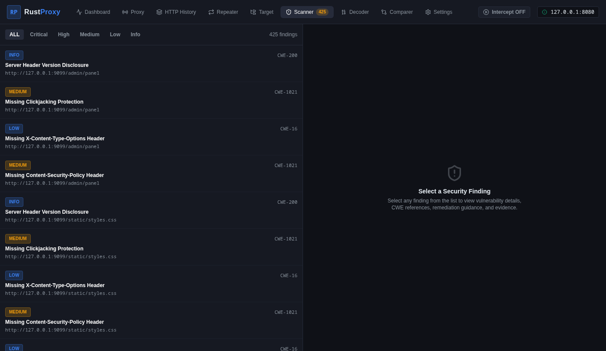
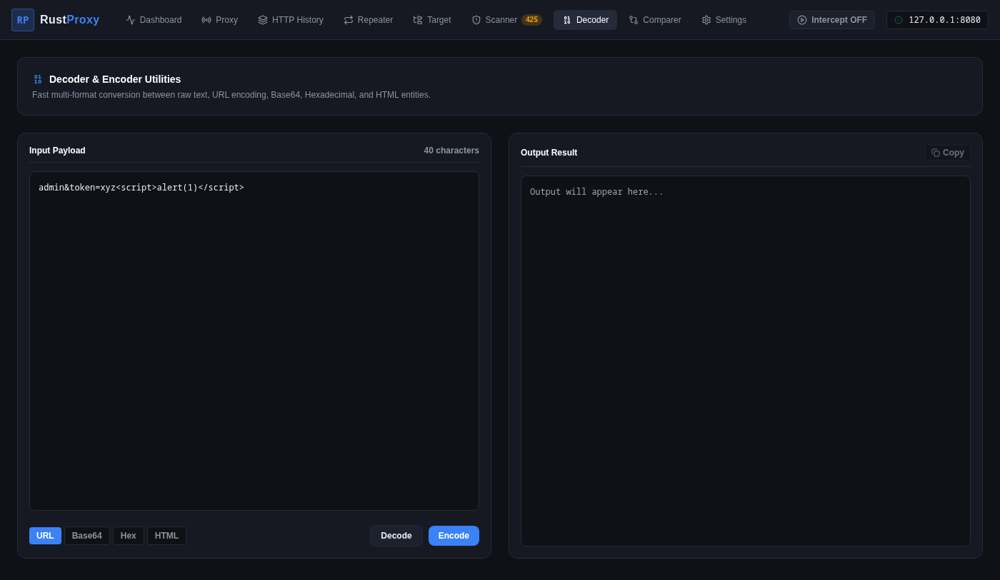
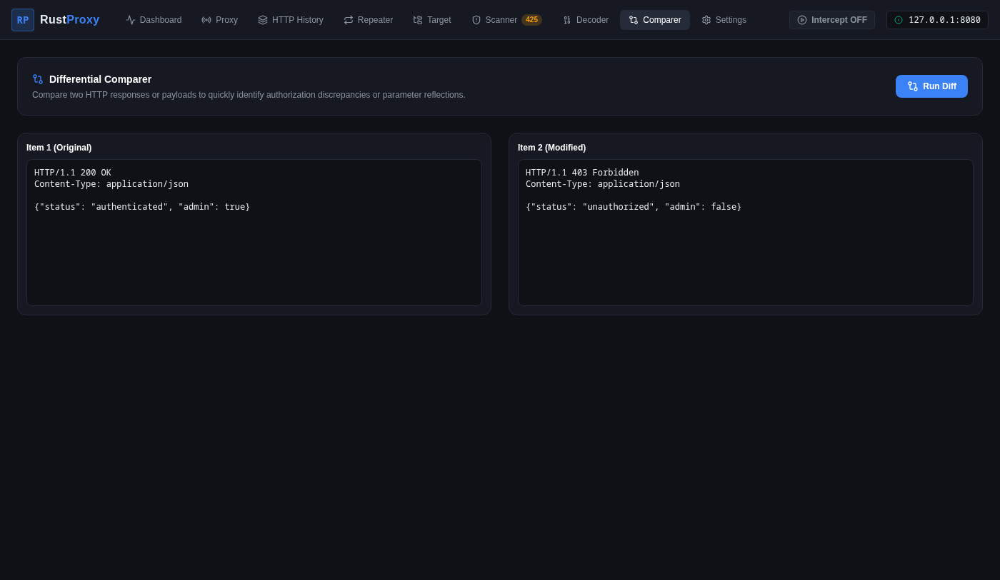

<div align="center">

# 🦀 RustProxy

**High-Performance Defensive Web Application Traffic Analysis & Security Testing Platform**

[](LICENSE)
[](https://www.rust-lang.org)
[](https://doc.rust-lang.org/edition-guide/rust-2021/)
[](https://github.com/balasaravanakumar7890/Rustproxy/releases/tag/v1.0.0)
[](docs/INSTALLATION.md)

*An independent, memory-safe, high-concurrency web security testing and debugging suite engineered with Rust, Tokio, Rustls, SQLite (WAL), and React 19.*

[Features](#-main-features) •
[Architecture](#-architecture-overview) •
[Installation](#-installation-instructions) •
[Quickstart](#-usage-quickstart) •
[Documentation](#-documentation) •
[Roadmap](#-development-roadmap)

</div>

---

## 📋 Table of Contents

- [Introduction & Purpose](#-introduction--purpose)
- [The Problem RustProxy Solves](#-the-problem-rustproxy-solves)
- [Main Features](#-main-features)
- [Screenshots & Visual Tour](#-screenshots--visual-tour)
- [Technology Stack](#-technology-stack)
- [Architecture Overview](#-architecture-overview)
- [Installation Instructions](#-installation-instructions)
- [Build Instructions](#-build-instructions)
- [Usage Quickstart](#-usage-quickstart)
- [Feature Status & Conformance](#-feature-status--conformance)
- [Development Roadmap](#-development-roadmap)
- [Security & Responsible-Use Disclaimer](#-security--responsible-use-disclaimer)
- [Contributing](#-contributing)
- [License](#-license)

---

## 🎯 Introduction & Purpose

**RustProxy** is an open-source, native web application traffic analysis, debugging, and defensive security testing suite. It is designed for software engineers, security researchers, and systems developers who need an independent, lightweight, and high-performance interception platform for testing web applications they own or are authorized to assess.

Engineered entirely in Rust, RustProxy delivers native memory safety, zero-cost abstractions, multi-threaded asynchronous I/O with Tokio, dynamic TLS Man-in-the-Middle (MITM) certificate synthesis via Rustls, and sub-millisecond SQLite WAL persistence.

---

## 💡 The Problem RustProxy Solves

Traditional web security testing proxies are often characterized by:
- **Heavy Resource Consumption**: High JVM or runtime memory footprints (frequently 1 GB to 2+ GB RSS) and high CPU overhead on developer workstations.
- **Proprietary Ecosystems & Paywalls**: Essential developer capabilities (such as search, filtering, and tabbed replay) locked behind expensive commercial tiers.
- **Complex Setups**: Convoluted dependency chains requiring specific JRE runtimes or browser-locked environments.

**RustProxy delivers an alternative**:
- **Native Efficiency**: Starts instantly with a ~18 MB idle footprint and <45 MB under heavy concurrent load.
- **Zero JVM Requirement**: Standalone 12 MB compiled binary with zero external runtime dependencies.
- **Modern Desktop Experience**: Clean, responsive dark-themed interface built on React 19, TypeScript, and Tailwind CSS.
- **100% Defensive Security**: Purpose-built for authorized diagnostics, local application auditing, and bug verification.

---

## 🚀 Main Features

| Module | Description |
| :--- | :--- |
| **Proxy & Interception** | Asynchronous HTTP/1.1 and HTTPS MITM proxy. Supports bidirectional request/response pausing, inline tampering, selective forwarding, and dropping. |
| **Dynamic TLS Synthesis** | Local ECDSA P-256 Root CA that dynamically generates X.509 v3 leaf certificates on-the-fly with requested SNI and loopback SAN mappings. |
| **HTTP History** | SQLite Write-Ahead Logging (WAL) audit log with real-time URL/method search, split-pane inspection, and bit-level BLOB storage. |
| **Repeater (Manual Replay)** | Multi-tab request editor with method selection, raw/structured header manipulation, payload editing, redirect tracking, and response timing. |
| **Target & Sitemap** | Automated tree visualization grouping observed endpoints by host and path segments, showing methods, status codes, and traffic counts. |
| **Passive Security Scanner** | Non-intrusive heuristic engine analyzing live flows for missing security headers (CSP, HSTS, X-Content-Type-Options) and insecure cookie attributes (CWE-1004, CWE-1021). |
| **Codec Utilities (Decoder)** | Instant transformation between raw text, URL encoding (RFC 3986), Base64 (RFC 4648), Hexadecimal, and HTML entities. |
| **Comparer (Diff Engine)** | Side-by-side textual and cryptographic diffing based on the Myers diff algorithm. |
| **Workstation Hardening** | Strict Cross-Origin Resource Sharing (CORS) origin validation protecting the local API from browser hijacking; Root CA private key locked to `0600` permissions. |

---

## 📸 Screenshots & Visual Tour

### Dashboard
*Real-time operational status, traffic metrics, host counters, and recent security findings.*


### Proxy Interception
*Bidirectional request and response interception queue with inline editing and drop controls.*


### HTTP History
*High-performance searchable audit log with split-pane request and response inspection.*


### Repeater (Manual Replay)
*Multi-tab request crafting workbench with live dispatch and response timing.*


### Target & Sitemap
*Hierarchical application structure discovery tree.*


### Passive Security Scanner
*Non-intrusive vulnerability heuristics with CWE mappings and actionable remediation.*


### Decoder & Encoder
*Multi-format transformation utility supporting URL, Base64, Hex, and HTML.*


### Comparer
*Side-by-side visual diff tool highlighting additions, deletions, and payload changes.*


---

## 🛠️ Technology Stack

- **Systems Language**: Rust 2021 (Rust 1.80+)
- **Asynchronous Runtime**: [Tokio](https://tokio.rs) (Multi-threaded async scheduler)
- **HTTP Engine**: [Hyper 1.0](https://hyper.rs) & `http-body-util`
- **TLS & Cryptography**: [Rustls 0.23](https://github.com/rustls/rustls) (with Ring provider) & [rcgen](https://github.com/est31/rcgen)
- **Storage**: [rusqlite](https://github.com/rusqlite/rusqlite) (SQLite 3 with WAL journal mode)
- **Desktop UI**: React 19, TypeScript 5.7, Tailwind CSS 3.4, Vite 6
- **Desktop Wrapper**: [Tauri v2](https://tauri.app)

---

## 🏗️ Architecture Overview

RustProxy is structured as a Cargo workspace with 13 modular crates:

```text
Rustproxy/
├── crates/
│   ├── rustproxy-core/         # HTTP models, TLS info, flow records, scope taxonomy
│   ├── rustproxy-tls/          # CA generation, dynamic leaf synthesis, Rustls resolver
│   ├── rustproxy-storage/      # SQLite WAL engine, metadata indexing & binary BLOBs
│   ├── rustproxy-http/         # Upstream Hyper client with connection establishment
│   ├── rustproxy-intercept/    # Interception queue and oneshot decision channels
│   ├── rustproxy-sitemap/      # URL tree aggregation and endpoint tracking
│   ├── rustproxy-repeater/     # Manual replay engine & tab management
│   ├── rustproxy-scanner/      # Passive heuristic vulnerability rules
│   ├── rustproxy-decoder/      # Multi-format codec (URL, Base64, Hex, HTML)
│   ├── rustproxy-comparer/     # Textual diffing engine
│   ├── rustproxy-proxy/        # Core proxy listener, CONNECT tunnel & event bus
│   ├── rustproxy-api/          # Local REST API server & static GUI asset host
│   └── rustproxy-cli/          # Application entrypoint binary
└── desktop/                    # React 19 + TypeScript frontend
```

For full architectural diagrams and data flow details, see [docs/ARCHITECTURE.md](docs/ARCHITECTURE.md).

---

## 📦 Installation Instructions

### Arch Linux (Primary Supported Platform)

Install required system libraries and toolchains:
```bash
sudo pacman -Syu --needed base-devel curl git pkgconf openssl sqlite webkit2gtk-4.1 libsoup3 gtk3 nodejs npm
```

Install the Rust toolchain:
```bash
curl --proto '=https' --tlsv1.2 -sSf https://sh.rustup.rs | sh -s -- -y
source "$HOME/.cargo/env"
```

For Ubuntu, Debian, Fedora, and pre-built binaries, see [docs/INSTALLATION.md](docs/INSTALLATION.md).

---

## 🔨 Build Instructions

Clone the repository and build the desktop bundle and Rust workspace:

```bash
# 1. Clone repository
git clone https://github.com/balasaravanakumar7890/Rustproxy.git
cd Rustproxy

# 2. Build desktop frontend assets
cd desktop
npm ci
npm run build
cd ..

# 3. Build optimized release binary
source "$HOME/.cargo/env"
cargo build --release
```

The compiled standalone executable will be located at:
```bash
target/release/rustproxy
```

---

## 🚦 Usage Quickstart

1. **Launch the Application**:
   ```bash
   ./target/release/rustproxy
   ```

2. **Access the Graphical Interface**:
   Open **`http://127.0.0.1:8081`** in any modern web browser or launch via Tauri.

3. **Configure Your Browser Proxy**:
   Configure your test browser or proxy extension (e.g. FoxyProxy) to route traffic through:
   - **Host**: `127.0.0.1`
   - **Port**: `8080`

4. **Trust the Root CA for HTTPS Inspection**:
   Import `~/.rustproxy/rustproxy_ca.crt` into your browser's Certificate Authorities store.

For complete step-by-step walkthroughs, see [docs/USAGE.md](docs/USAGE.md).

---

## 📊 Feature Status & Conformance

| Capability | Status in v1.0.0 | Notes |
| :--- | :--- | :--- |
| **HTTP/1.1 Keep-Alive** | :white_check_mark: Supported | Pipelined sequential requests over persistent connections |
| **Chunked Transfer Encoding** | :white_check_mark: Supported | Transparent streaming chunk reassembly |
| **Large Payload Handling** | :white_check_mark: Supported | Verified with 5 MB request and response bodies |
| **Binary Transparency** | :white_check_mark: Supported | Full 8-bit fidelity across all bytes (`0x00`–`0xFF`) |
| **HTTP Redirects & Cookies** | :white_check_mark: Supported | Header preservation and automatic Repeater following |
| **Bidirectional Intercept** | :white_check_mark: Supported | Outbound request and inbound response tampering/dropping |
| **HTTP/2 ALPN** | :hourglass_flowing_sand: HTTP/1.1 Fallback | ALPN negotiates `http/1.1`; native HTTP/2 planned for v1.1 |
| **WebSockets** | :hourglass_flowing_sand: TCP Passthrough | Tunnel passthrough; deep frame dissection planned for v1.1 |

For complete quality audit data and benchmarks, see [QUALITY_AUDIT.md](QUALITY_AUDIT.md).

---

## 🗺️ Development Roadmap

- **v1.0.0 (Current)**: Stable HTTP/HTTPS proxy, bidirectional interception, SQLite WAL history, Repeater, Sitemap, passive scanner, codecs, diff comparer, React 19 GUI.
- **v1.1 (Planned)**: Native HTTP/2 frame multiplexing, WebSocket RFC 6455 frame inspector, upstream proxy chaining.
- **v1.2 (Planned)**: Advanced query filtering DSL, syntax highlighting in Repeater, expanded passive rules, OpenAPI 3.0 import.
- **Future**: WebAssembly sandboxed plugin architecture, session archive export (HAR), cross-platform desktop installers.

See [docs/ROADMAP.md](docs/ROADMAP.md) for full details.

---

## 🔒 Security & Responsible-Use Disclaimer

> [!CAUTION]
> RustProxy is designed solely for defensive application security testing, local debugging, and authorized research on systems you own or have explicit authorization to test.
> Unauthorized testing against systems without prior mutual agreement is unlawful. The authors and maintainers assume no liability for misuse.

See [SECURITY.md](SECURITY.md) for our security policy and reporting guidelines.

---

## 🤝 Contributing

Contributions, bug reports, and enhancements are warmly welcome! Please review our [Contributing Guide](CONTRIBUTING.md) and [Developer Guide](docs/DEVELOPMENT.md) before submitting pull requests.

---

## 📄 License

This project is open-source software licensed under the [MIT License](LICENSE).
Copyright (c) 2026 Bala Saravana Kumar.
